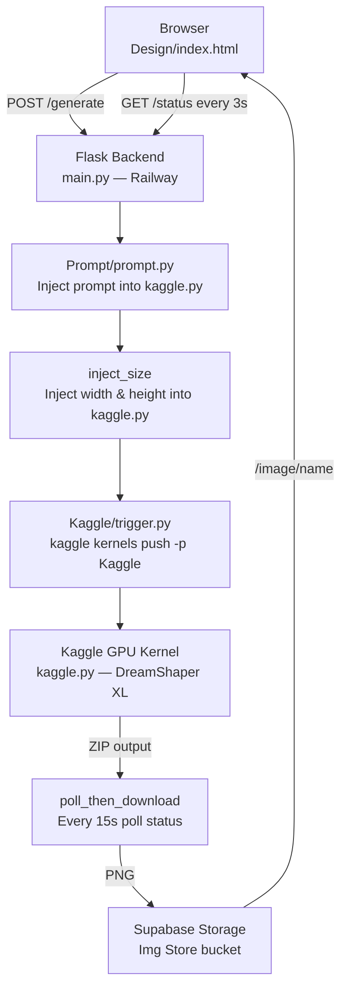

<div align="center">

# 🎨 Studio AI — Free GPU Image Generator

**Generate high-resolution AI images using free Kaggle GPUs — no paid API needed.**

[](https://python.org)
[](https://flask.palletsprojects.com)
[](https://supabase.com)
[](https://kaggle.com)
[](https://vercel.com)
[](https://railway.app)

**Model:** `Lykon/dreamshaper-xl-v2-turbo` (Stable Diffusion XL Turbo)

</div>

---


## 📋 Table of Contents

1. [Overview](#-overview)
2. [Features](#-features)
3. [Architecture](#-architecture)
4. [Folder Structure](#-folder-structure)
5. [Local Setup](#-local-setup)
6. [Environment Variables](#-environment-variables)
7. [Kaggle Setup](#-kaggle-setup)
8. [Supabase Setup](#-supabase-setup)
9. [Deploy to Vercel (Frontend)](#-deploy-to-vercel-frontend)
10. [Deploy to Railway (Backend)](#-deploy-to-railway-backend)
11. [API Reference](#-api-reference)
12. [Aspect Ratios](#-aspect-ratios)
13. [Troubleshooting](#-troubleshooting)

---

## 🌟 Overview

Studio AI solves one problem: **AI image generation is the expensive tool.** Tools like DALL-E, Midjourney, and Stability AI all cost money.

This project uses **Kaggle's free GPU tier** (T4 / P100, 30 hrs/week) to run Stable Diffusion XL in cloud. You type a prompt in the browser, click Generate, and the system:

1. Injects your prompt & resolution into the Kaggle script
2. Pushes it to Kaggle and triggers a GPU kernel
3. Polls until done (~1–3 min), downloads the PNG
4. Uploads to **Supabase Storage** for permanent access
5. Displays the result in the browser

---

## ✨ Features

| Feature | Details |
|---|---|
| 🆓 Free GPU | Kaggle Tesla T4, 30 hrs/week at zero cost |
| 🎨 Studio UI | Dark-mode, glassmorphism, smooth animations |
| 📐 6 Aspect Ratios | Square, Wide, Classic, Portrait, Story, Cinema |
| 🎲 Surprise Me | 10 built-in creative prompt suggestions |
| 📊 Live Status | Real-time polling — shows elapsed time while GPU runs |
| ☁️ Auto-Save | Every image uploaded to Supabase Storage automatically |
| ⬇️ Download | One-click download from toolbar after generation |
| 🔄 Manual Fetch | Force-download latest kernel output any time |
| 🔁 Retry Logic | Auto-retries download 3× before reporting failure |

---

## 🏗 Architecture




---

## 📁 Folder Structure

```
AI-Img-Generator/
├── main.py                  # Flask backend — all API routes & pipeline logic
├── requirements.txt         # Python dependencies
├── .env                     # Secret keys (never commit!)
├── .gitignore               # Excludes .env
├── patch_index.py           # One-time patch: adds Download button to UI
├── fix_layout.py            # One-time patch: fixes image canvas layout
│
├── Design/
│   ├── index.html           # Full Studio AI frontend (dark UI)
│   ├── vercel.json          # Vercel deployment config
│   └── output/              # Local image cache (auto-created)
│
├── Prompt/
│   ├── prompt.json          # Active prompt + size (auto-written by backend)
│   └── prompt.py            # Injects prompt into Kaggle/kaggle.py
│
└── Kaggle/
    ├── kaggle.py            # Script that runs ON Kaggle GPU (SDXL model)
    ├── trigger.py           # Pushes kaggle.py and triggers execution
    ├── store.py             # Standalone: manual download + Supabase upload
    └── kernel-metadata.json # Kernel config (ID, GPU enabled, internet on)
```

---

## 💻 Local Setup

### Prerequisites
- Python 3.10+
- Kaggle account + API key
- Supabase account (free tier)

### Steps

```bash
# 1. Clone
git clone https://github.com/YOUR_USERNAME/AI-Img-Generator.git
cd AI-Img-Generator

# 2. Virtual environment
python -m venv venv
venv\Scripts\activate        # Windows
# source venv/bin/activate   # macOS/Linux

# 3. Install dependencies
pip install -r requirements.txt

# 4. Create .env file (see Environment Variables section)

# 5. One-time UI patches (run once after cloning)
python patch_index.py
python fix_layout.py

# 6. Run
python main.py
```

Open **http://localhost:5000**

---

## 🔐 Environment Variables

Create `.env` in the project root:

```env
KAGGLE_USERNAME=your_kaggle_username
KAGGLE_KEY=your_kaggle_api_key
SUPABASE_URL=https://YOUR_PROJECT_ID.supabase.co
SUPABASE_KEY=your_supabase_service_role_key
SUPABASE_BUCKET=Img Store
```

| Variable | Required | Note |
|---|---|---|
| `KAGGLE_USERNAME` | ✅ | Your Kaggle username |
| `KAGGLE_KEY` | ✅ | Kaggle API key |
| `SUPABASE_URL` | ✅ | Supabase project URL |
| `SUPABASE_KEY` | ✅ | **Service role key** — NOT the anon key |
| `SUPABASE_BUCKET` | Optional | Default: `Img Store` |

> ⚠️ Use the **service_role** key — the anon key is blocked by RLS for uploads.

---

## 🏁 Kaggle Setup

1. Sign up at [kaggle.com](https://kaggle.com) (free)
2. **Account → Settings → API → Create New Token** → copy `username` and `key` to `.env`
3. Create a new notebook at [kaggle.com/code](https://www.kaggle.com/code):
   - Name it **`img-generator`**
   - Enable **GPU** accelerator
   - Enable **Internet** access
   - Run it once manually to register the kernel slot
4. Edit `Kaggle/kernel-metadata.json`:

```json
{
  "id": "YOUR_KAGGLE_USERNAME/img-generator",
  "title": "Img Generator",
  "code_file": "kaggle.py",
  "language": "python",
  "kernel_type": "script",
  "is_private": true,
  "enable_gpu": true,
  "enable_internet": true,
  "dataset_sources": []
}
```

5. Verify: `kaggle kernels list --mine`

---

## 🗄 Supabase Setup

1. Create a project at [supabase.com](https://supabase.com) (free tier)
2. Go to **Settings → API** and copy:
   - **Project URL** → `SUPABASE_URL`
   - **service_role secret** → `SUPABASE_KEY`
3. Go to **Storage → New Bucket**:
   - Name: `Img Store`
   - Visibility: **Public** (required for browser display)

---

## 🚀 Deploy to Vercel (Frontend)

Vercel hosts the static `Design/` folder.

1. Push your code to GitHub
2. Go to [vercel.com](https://vercel.com) → **New Project** → Import repo
3. **Root Directory:** set to `Design`
4. **Framework:** Other
5. Click **Deploy**

The `Design/vercel.json` is already configured — no changes needed:

```json
{
  "rewrites": [{ "source": "/(.*)", "destination": "/index.html" }],
  "headers": [{
    "source": "/(.*)",
    "headers": [
      { "key": "X-Content-Type-Options", "value": "nosniff" },
      { "key": "X-Frame-Options", "value": "DENY" }
    ]
  }]
}
```

After deploy, update the backend URL in `Design/index.html`:
```javascript
const API_BASE = "https://your-backend.railway.app";
```

---

## 🟣 Deploy to Railway (Backend)

Railway runs `main.py` 24/7.

1. Go to [railway.app](https://railway.app) → **New Project → Deploy from GitHub**
2. Select your repository
3. Add environment variables in **Variables** tab (all from `.env`)
4. Create a `Procfile` in the project root:

```
web: gunicorn main:app --bind 0.0.0.0:$PORT --workers 1 --timeout 120
```

> Use `--workers 1` — the pipeline state is stored in memory; multiple workers will lose state.

5. In `main.py`, add your Vercel URL to CORS:

```python
CORS(app, origins=[
    "https://your-app.vercel.app",
    r"https://.*\.vercel\.app",
    "http://localhost:5000",
])
```

6. Railway generates your backend URL under **Settings → Networking → Generate Domain**

---

## 📡 API Reference

| Method | Endpoint | Description |
|---|---|---|
| `GET` | `/` | Serves `index.html` frontend |
| `POST` | `/generate` | Starts image generation pipeline |
| `GET` | `/status` | Current pipeline state (browser polls this) |
| `GET` | `/surprise` | Returns a random prompt |
| `GET` | `/last-image` | Most recently generated image URL |
| `POST` | `/fetch-now` | Force-download latest Kaggle output |
| `POST` | `/reset` | Reset pipeline to idle |
| `GET` | `/image/<name>` | Proxy image from Supabase |
| `GET` | `/download/<name>` | Download image as attachment |

**POST `/generate` body:**
```json
{ "prompt": "A futuristic city at golden hour", "ratio": "16:9 Wide" }
```

**GET `/status` response:**
```json
{ "status": "waiting", "message": "Kaggle GPU rendering... 1m 30s elapsed", "image": null }
```

Status values: `idle` → `running` → `waiting` → `done` / `error`

---

## 📐 Aspect Ratios

| Name | Resolution | Best For |
|---|---|---|
| 1:1 Square | 1024 × 1024 | Instagram posts |
| 16:9 Wide | 1920 × 1080 | YouTube / wallpapers |
| 4:3 Classic | 1440 × 1080 | Photography / blogs |
| 3:4 Portrait | 1080 × 1440 | Pinterest |
| 9:16 Story | 1080 × 1920 | Instagram / TikTok Stories |
| 21:9 Cinema | 2560 × 1080 | Ultra-wide wallpapers |

> The backend auto-calculates an optimal ~1MP generation size for SDXL, then upscales to the exact target using LANCZOS resampling.

---

## ❓ Troubleshooting

**Kernel error on Kaggle**
- Check kernel logs at [kaggle.com/code](https://kaggle.com/code)
- Ensure `"enable_internet": true` in `kernel-metadata.json`

**Timed out (15 min)**
- Click **Fetch Image** — if the kernel finished it will still download
- Or run `python Kaggle/store.py` to download manually

**SUPABASE_KEY error**
- Use the **service_role** key from Supabase Settings → API, not the anon key

**PROMPT_START marker missing**
- Restore these markers manually at the top of `Kaggle/kaggle.py`:

```python
# <<PROMPT_START>> auto-injected by Prompt/prompt.py - do not edit manually
CURRENT_PROMPT = """your test prompt here"""
# <<PROMPT_END>>

# <<SIZE_START>> auto-injected by app.py - do not edit manually
TARGET_WIDTH = 1024
TARGET_HEIGHT = 1024
# <<SIZE_END>>
```

**CORS error in browser**
- Add your Vercel URL to the `CORS(app, origins=[...])` list in `main.py` and redeploy

**`kaggle` not found on Railway**
- It installs from `requirements.txt` automatically
- Railway reads `KAGGLE_USERNAME` / `KAGGLE_KEY` env vars — no `kaggle.json` file needed

---

## 🤝 Contributing

```bash
git checkout -b feature/your-feature
# make changes, test with: python main.py
git commit -m "Add your feature"
git push origin feature/your-feature
# open a Pull Request
```

**Ideas:** negative prompts · batch generation · image history gallery · FLUX / SDXL Lightning support · mobile layout

---

<div align="center">

MIT License — **Made with free Kaggle GPUs** ⭐

</div>
